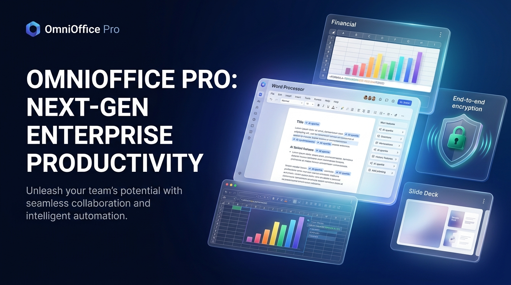

# OmniOffice Pro — Enterprise Cloud Office Suite & Collaborative Workspace



<p align="center">
  <strong>Next-Generation Cloud Office Suite for Teams & Individuals</strong><br>
  Documents • Spreadsheets • Presentations • Encrypted Notes • Gemini 3.8 AI • Offline PWA
</p>

<p align="center">
  <a href="https://www.paypal.com/paypalme/luciferamorgenster" target="_blank">
    
  </a>
  
  
  
  
</p>

---

## 💖 Support & Sponsor / Ondersteun de Ontwikkelaar

If you love **OmniOffice Pro** and want to support ongoing development, new AI models, and feature updates, you can sponsor directly via PayPal:

👉 **[Sponsor via PayPal: luciferamorgenster@gmail.com](https://www.paypal.com/paypalme/luciferamorgenster)**

Your support helps maintain open-source innovation, high-availability cloud sync, and military-grade privacy tools. Thank you!

---

## 🌐 Language Selector / Taalkeuze / Sprachauswahl / Choix de langue

- [English Documentation](#-english-overview)
- [Nederlandse Documentatie](#-nederlands-overzicht)
- [Deutsche Dokumentation](#-deutsche-übersicht)
- [Documentation en Français](#-vue-densemble-en-français)

---

## 🇬🇧 English Overview

**OmniOffice Pro** is a modern, high-performance web and progressive web application (PWA) office suite built for enterprise agility, data privacy, and seamless team collaboration.

### ✨ Key Features

1. **📄 Word Processor (Docs)**
   - Rich typography & formatting: Headings (H1–H3), bold, italics, quotes, code blocks, lists, alignments, and text highlighting.
   - Real-time word count, character count, and estimated reading time.
   - **Gemini 3.8 Flash AI Assistant**: Instant summarization, grammar & spell check, diplomatic corporate tone conversion, detailed elaboration, and custom prompting.
   - **Version History & Rollbacks**: Create named checkpoints and restore previous versions with one click.
   - **Inline Collaboration**: Team commentary threads, replies, resolved tags, and live cursor presence.
   - **Export Options**: Export directly to Markdown (`.md`), HTML, plain text, and browser print-to-PDF.

2. **📊 Spreadsheet Engine (Sheets)**
   - Interactive cell grid with formula evaluation bar.
   - Formula computation engine: `=SUM()`, `=AVERAGE()`, `=MIN()`, `=MAX()`, `=COUNT()`, `=IF()`, and arithmetic equations.
   - Formatting: Currency (`$`, `€`, `£`), percentages (`%`), numeric decimals, custom fill colors, and bold.
   - **Interactive Visual Charts**: Dynamic Bar Charts, Line Charts, and Pie Charts updated instantly as cell values change.
   - **AI Data Analyst**: Automated trend analysis, anomaly detection, and formula recommendations powered by Gemini 3.8.
   - **CSV Integration**: Export to CSV or import existing CSV datasets.

3. **📽️ Presentation Maker (Slides)**
   - Visual slide sorter with thumbnail carousel: add, clone, reorder, and delete slides.
   - Custom layouts (Title slide, content, bullet points, split layout) and curated background themes.
   - Presenter / Speaker notes panel for rehearsing presentations.
   - **Full-Screen Presentation Player**: Keyboard navigation (arrow keys/spacebar), timer stopwatch, slide progress counter, and escape handling.
   - **AI Slide Generator**: Generate structured 4+ slide pitches or proposals in seconds from any prompt.

4. **🔒 Notes, Security Vault & Calendar Tasks**
   - Sticky notes board with tags, image attachments, and search.
   - **Client-Side End-to-End Encryption (E2EE)**: True 256-bit AES-GCM encryption with PBKDF2 key derivation (100,000 iterations). Your confidential notes and sensitive documents never leave your browser unencrypted.
   - **Biometric Authentication**: Simulated Touch ID / Face ID / Windows Hello unlock modal.
   - **Task & Deadline Management**: Set due dates, priorities (*Low, Medium, High, Urgent*), and assignees.
   - **iCalendar (.ics) Export**: One-click calendar sync with Google Calendar, Apple Calendar, and Microsoft Outlook.

5. **📱 Multi-Device Adaptive Interface & PWA**
   - **Device View Simulator**: Test and experience the app in full Desktop mode, iPad / Tablet bezel, iPhone (iOS) with Dynamic Island, or Android Punch-Hole frame.
   - **PWA Ready**: Offline caching with Service Worker, `manifest.webmanifest`, high-res maskable icons, and native install prompt (`PWAInstallButton`).
   - **Dark Mode & 5 Vibrant Themes**: Royal Blue, Emerald Green, Cyber Purple, Warm Amber, and Slate.

---

## 🇳🇱 Nederlands Overzicht

**OmniOffice Pro** is een compleet enterprise cloud office pakket ontworpen voor maximale productiviteit, end-to-end privacy en soepele teamsamenwerking.

### ✨ Belangrijkste Functies

1. **📄 Tekstverwerker (Documenten)**
   - Rijke opmaak: Koppen (H1, H2, H3), vet, cursief, opsommingen, citaten, codeblokken en tabelopmaak.
   - **Gemini 3.8 Flash AI Assistent**: Samenvatten, spelling- en grammaticacontrole, zakelijke toonconversie, uitbreiden en vrije opdrachten.
   - **Versiegeschiedenis**: Automatische herstelpunten aanmaken en revisies terugzetten.
   - **Samenwerking**: Teamleden kunnen reacties plaatsen, beantwoorden en elkaars aanwezigheid zien.
   - **Exporteren**: Exporteer naar Markdown (`.md`), afdrukken naar PDF en HTML.

2. **📊 Rekenbladen (Sheets)**
   - Formule-engine: `=SOM(...)`, `=GEMIDDELDE(...)`, `=MIN(...)`, `=MAX(...)`, `=AANTAL(...)`, `=ALS(...)` en wiskunde.
   - Valuta-opmaak (`€`), percentages en uitlijning.
   - **Dynamische grafieken**: Live staaf-, lijn- en cirkeldiagrammen gekoppeld aan je cellen.
   - **AI Data Analist**: Automatische trends en uitschieters detecteren met Gemini.
   - **CSV Export & Import**: Eenvoudig uitwisselen met Excel of data science tools.

3. **📽️ Presentaties (Dia's)**
   - Diakiezer met toevoegen, kopiëren en verwijderen.
   - Sprekersnotities per dia.
   - **Volledig scherm Presentatiemodus**: Toetsenbordbediening, presentatietimer en voortgangsteller.
   - **AI Slide Maker**: Genereer met één klik een complete presentatiestructuur op basis van een onderwerp.

4. **🔒 Notities, Beveiligingskluis & Taken**
   - Wachtwoordbeveiligde en biometrische (vingerafdruk / Face ID) ontgrendeling.
   - **Client-Side 256-bit AES-GCM encryptie**: Geen onversleutelde gegevens naar servers.
   - **Takenbeheer**: Deadlines, prioriteiten en iCalendar (`.ics`) export voor Google Agenda en Apple Calendar.

5. **📱 PWA & Offline Toegang**
   - Installeerbaar als native applicatie op Windows, macOS, Android en iOS.
   - Volledige offline modus met automatische synchronisatie zodra de verbinding herstelt.

---

## 🇩🇪 Deutsche Übersicht

**OmniOffice Pro** ist eine moderne Enterprise-Cloud-Office-Suite für produktive Teamarbeit und höchste Datensicherheit.

- **Dokumente**: Umfangreiche Textverarbeitung mit Versionsverlauf, Gemini 3.8 KI-Assistent, Team-Kommentaren und PDF/Markdown-Export.
- **Tabellenkalkulation**: Integrierte Formel-Engine (`=SUMME`, `=MITTELWERT`, `=WENN`), interaktive Diagramme (Balken, Linien, Kreis) und KI-Datenanalyse.
- **Präsentationen**: Folien-Editor, Referentennotizen, KI-Präsentationsgenerator und nativer Vollbild-Präsentationsmodus mit Timer.
- **Ende-zu-Ende-Verschlüsselung (E2EE)**: 256-Bit-AES-GCM mit PBKDF2 und simulierter biometrischer Authentifizierung.
- **PWA & Offline**: Vollständig offlinefähig, automatische Synchronisierung und installierbar auf Desktop und Mobilgeräten.

---

## 🇫🇷 Vue d'ensemble en Français

**OmniOffice Pro** est une suite bureautique cloud d'entreprise alliant collaboration en temps réel, intelligence artificielle avancée et chiffrement militaire.

- **Traitement de texte**: Mise en page riche, historique des versions, assistant IA Gemini 3.8, commentaires d'équipe et export PDF / Markdown.
- **Tableur interactif**: Moteur de calcul (`=SOMME`, `=MOYENNE`, `=SI`), graphiques dynamiques en temps réel et analyse de données par IA.
- **Présentations**: Gestionnaire de diapositives, notes de l'orateur, générateur IA et mode diaporama plein écran avec chronomètre.
- **Sécurité maximale (E2EE)**: Chiffrement client AES-GCM 256 bits, dérivation PBKDF2 et déverrouillage biométrique simulé.
- **Application PWA**: Fonctionne hors-ligne et s'installe en un clic sur iOS, Android, macOS et Windows.

---

## 🛠️ Tech Stack & Architecture

- **Frontend**: React 19, TypeScript, Tailwind CSS v4, Motion, Lucide Icons
- **Backend / Full-Stack**: Node.js, Express, Vite Server Middleware (`server.ts`)
- **Artificial Intelligence**: Google `@google/genai` TypeScript SDK (`gemini-3.8-flash`)
- **Security & Cryptography**: Native Web Crypto API (`window.crypto.subtle`) — AES-GCM 256 & PBKDF2
- **PWA & Offline**: Service Worker (`sw.js`), Web App Manifest, Cache API, LocalStorage persistence

---

## 🚀 Getting Started

### Prerequisites
- Node.js `>= 18.0.0`
- npm or pnpm

### Installation

```bash
# Clone the repository
git clone https://github.com/your-username/omnioffice-pro.git

# Navigate into project directory
cd omnioffice-pro

# Install dependencies
npm install

# Start the full-stack server
npm run dev
```

Visit `http://localhost:3000` in your browser.

---

## ☕ Sponsor & Contact

Developed with care by **Lucifera Morgenster**.

- **PayPal Sponsor**: [luciferamorgenster@gmail.com](https://www.paypal.com/paypalme/luciferamorgenster)
- **Direct Email**: [luciferamorgenster@gmail.com](mailto:luciferamorgenster@gmail.com)

Distributed under the Apache 2.0 License.
